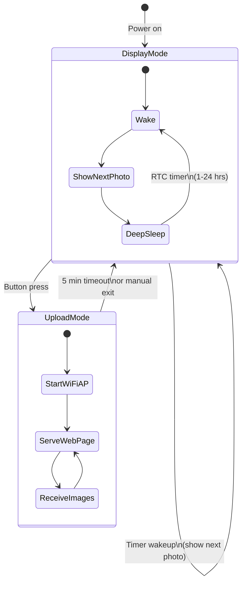
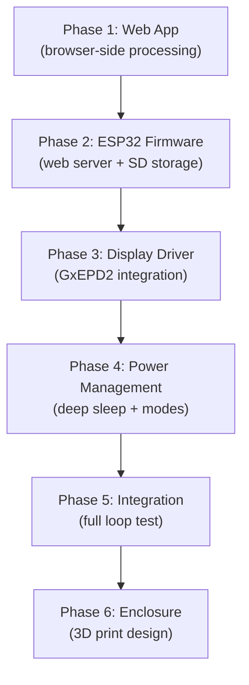

# DIY E-Ink Photo Album (PicPak Clone) — Self-Contained

A battery-powered, self-hosted e-ink photo frame. The ESP32 **is** the server — no PC, no Raspberry Pi, no cloud. Upload photos and videos directly from your phone's browser.

## System Overview

```mermaid
flowchart LR
    subgraph phone["Your Phone / PC"]
        A["Browser"]
        B["JS: Resize + Crop"]
        C["JS: Floyd-Steinberg\nDithering (4-color)"]
        D["JS: Video Frame\nExtraction"]
    end
    subgraph device["E-Ink Frame (self-contained)"]
        E["ESP32-S3\n(WiFi AP + Web Server)"]
        F["MicroSD Card\n(photo storage)"]
        G["4.2\" E-Ink\n(B/W/R/Y)"]
        H["LiPo Battery"]
    end

    A -- "Pick photo\nor video" --> B
    B --> C
    D --> B
    A -- "Pick video" --> D
    C -- "POST /upload\n(30KB raw pixels)" --> E
    E --> F
    E -- "SPI" --> G
    H --> E
```

### The Key Trick

The browser does **all** the heavy lifting — resizing, cropping, dithering, video frame extraction. The ESP32 only receives a tiny pre-processed binary (30,000 bytes), stores it on the SD card, and writes it to the display. This sidesteps the ESP32's RAM/CPU limitations entirely.

---

## Two Operating Modes



| Mode | What Happens | Power Usage |
|------|-------------|-------------|
| **Display Mode** (default) | Deep sleep → wake → show next photo from SD → deep sleep | ~10µA sleep, ~150mA for 15s every cycle |
| **Upload Mode** (button press) | ESP32 creates WiFi hotspot `"EinkFrame"`, serves web page at `192.168.4.1`, accepts uploads | ~120mA continuous (5 min timeout) |

---

## Hardware Bill of Materials

| # | Component | Approx. Cost | Notes |
|---|-----------|-------------|-------|
| 1 | **Waveshare 4.2" e-Paper Module (G)** — B/W/R/Y, 400×300px | \$25–30 | SPI, ~21s full refresh |
| 2 | **ESP32-S3-DevKitC-1** (with 8MB PSRAM) | \$10–15 | PSRAM helps buffer uploads; built-in USB-C |
| 3 | **MicroSD card module** (SPI) + 4GB+ MicroSD card | \$3–5 | Stores ~100,000 processed images |
| 4 | **3.7V LiPo Battery** (2000mAh, JST-PH 2.0) | \$8–10 | ~1 year at 1 refresh/hour |
| 5 | **TP4056 USB-C LiPo charger module** | \$1–2 | Handles charging; some ESP32-S3 boards have this built-in |
| 6 | **Tactile button** (6mm) | \$0.25 | "Upload mode" trigger |
| 7 | **P-Channel MOSFET** (AO3401) + 10kΩ resistor | \$0.75 | Cuts display power during deep sleep |
| 8 | **Dupont wires, headers, perfboard** | \$3 | For assembly |
| 9 | **3D-printed enclosure** | \$2–5 filament | PLA or PETG |

**Estimated total: ~\$55–75**

---

## Wiring

```
ESP32-S3-DevKitC-1           Waveshare 4.2" (G)
──────────────────           ──────────────────
3.3V ─── [MOSFET Drain] ──── VCC        (power-gated)
GND  ────────────────────── GND
GPIO 11 (MOSI) ──────────── DIN
GPIO 12 (SCK)  ──────────── CLK
GPIO 10 (CS)   ──────────── CS
GPIO  9 (DC)   ──────────── DC
GPIO  8 (RST)  ──────────── RST
GPIO 14 (BUSY) ──────────── BUSY

ESP32-S3                     MicroSD Module (SPI)
──────────────────           ──────────────────
3.3V ───────────────────── VCC
GND  ───────────────────── GND
GPIO 36 (MOSI) ─────────── MOSI        (second SPI bus - HSPI)
GPIO 37 (SCK)  ─────────── SCK
GPIO 35 (CS)   ─────────── CS
GPIO 38 (MISO) ─────────── MISO

Power Control (MOSFET)
──────────────────────
GPIO 21 ──── 10kΩ ──── Gate (AO3401)
3.3V ─────────────── Source (AO3401)
                       Drain ──── e-Paper VCC

Upload Button
─────────────
GPIO 0  ──── Button ──── GND          (built-in pull-up, wake from deep sleep)

Battery Monitoring
──────────────────
VBAT ─── 100kΩ ──┬── GPIO 1 (ADC)
                  100kΩ
                  GND
```

> [!TIP]
> The ESP32-S3 has two hardware SPI buses. We use **FSPI** for the e-ink display and **HSPI** for the SD card so they don't conflict.

> [!NOTE]
> GPIO 0 supports `ext0` wakeup from deep sleep, making it ideal for the upload-mode button. A press during deep sleep wakes the device directly into upload mode.

---

## Software Architecture

### Component 1: ESP32 Firmware (C++ / PlatformIO)

#### [NEW] [firmware/platformio.ini](file:///d:/antigravity/firmware/platformio.ini)
- Target: `esp32-s3-devkitc-1`
- Framework: Arduino
- Dependencies: `GxEPD2`, `ESPAsyncWebServer`, `AsyncTCP`, `SD`, `ArduinoJson`, `ESPmDNS`, `DNSServer`
- Partition scheme: `default_16MB.csv` (or `huge_app.csv` for 8MB flash)

#### [NEW] [firmware/src/main.cpp](file:///d:/antigravity/firmware/src/main.cpp)
Core state machine:

```
Boot → Check wake reason
  ├── RTC Timer → Display Mode
  │     1. Power on display (MOSFET)
  │     2. Read next image from SD card
  │     3. Write to e-ink, trigger refresh
  │     4. Update index file on SD
  │     5. Power off display
  │     6. Deep sleep (configurable 1-24 hours)
  │
  └── Button Press (GPIO 0) → Upload Mode
        1. Start WiFi AP ("EinkFrame" / "EinkFrame-XXXX")
        2. Start DNS server (captive portal)
        3. Start mDNS ("einkframe.local")
        4. Start AsyncWebServer
        5. Serve web app from LittleFS (gzipped HTML/JS/CSS)
        6. Handle upload POST requests → save to SD
        7. Display "Upload Mode" status on e-ink screen
        8. After 5 min idle → return to Display Mode
```

#### [NEW] [firmware/src/config.h](file:///d:/antigravity/firmware/src/config.h)
- Pin definitions (all GPIO numbers from wiring diagram)
- AP SSID/password
- Default refresh interval
- SD card paths (`/photos/`, `/config.json`)

#### [NEW] [firmware/src/display_driver.h](file:///d:/antigravity/firmware/src/display_driver.h) / `.cpp`
- Thin wrapper around GxEPD2 for the 4.2" Module (G)
- `init()`, `showImage(const char* sdPath)`, `showStatusScreen(const char* msg, int battery%)`, `powerOff()`
- Reads raw 30KB files from SD and writes directly to display buffer

#### [NEW] [firmware/src/web_server.h](file:///d:/antigravity/firmware/src/web_server.h) / `.cpp`
- Sets up `ESPAsyncWebServer` on port 80
- Routes:
  - `GET /` → serve `index.html.gz` from LittleFS
  - `GET /app.js` → serve `app.js.gz` from LittleFS
  - `GET /style.css` → serve `style.css.gz` from LittleFS
  - `POST /api/upload` → receive raw 30KB image, save to SD as `/photos/NNNN.bin`
  - `GET /api/photos` → JSON list of stored photos with metadata
  - `DELETE /api/photos/:id` → delete a photo
  - `POST /api/settings` → update refresh interval, cycling order
  - `GET /api/status` → battery %, photo count, current index, uptime
  - `POST /api/display/:id` → immediately display a specific photo

#### [NEW] [firmware/src/sd_manager.h](file:///d:/antigravity/firmware/src/sd_manager.h) / `.cpp`
- SD card initialization and file management
- `savePhoto(uint8_t* data, size_t len) → int id`
- `loadPhoto(int id, uint8_t* buffer)`
- `getNextPhotoId() → int` (round-robin through stored images)
- `deletePhoto(int id)`
- `getPhotoCount() → int`
- `loadSettings()` / `saveSettings()` — JSON config stored as `/config.json`

#### [NEW] [firmware/src/power.h](file:///d:/antigravity/firmware/src/power.h) / `.cpp`
- `readBatteryVoltage() → float` (ADC with voltage divider)
- `batteryPercent(float voltage) → int` (LiPo discharge curve lookup)
- `enableDisplayPower()` / `disableDisplayPower()` (MOSFET control)
- `enterDeepSleep(uint64_t microseconds, bool enableButtonWake)`

---

### Component 2: Web Upload App (HTML/JS/CSS — stored on ESP32's LittleFS)

> [!IMPORTANT]
> The entire web app is a **single self-contained page** — all HTML, CSS, and JS are embedded/inlined and gzip-compressed into LittleFS (~30-50KB total). No CDN, no external dependencies. It works in airplane mode because the ESP32 IS the network.

#### [NEW] [firmware/data/index.html](file:///d:/antigravity/firmware/data/index.html)
Responsive single-page app with these sections:

**Upload Area:**
- Drag-and-drop zone or "tap to select" (supports multi-file)
- Accepts images (`image/*`) and videos (`video/*`)
- For images: auto-crops to 4:3, resizes to 400×300, applies Floyd-Steinberg dithering to {Black, White, Red, Yellow} palette
- For videos: shows a scrubber/timeline, lets user pick a frame, then processes like an image
- Shows live **before/after preview** (original → dithered e-ink simulation)
- User confirms → processed 30KB binary POSTed to ESP32

**Gallery:**
- Thumbnail grid of all uploaded photos (fetched via `/api/photos`)
- Tap to preview, long-press to delete
- "Display Now" button per photo
- Drag to reorder (updates display sequence)

**Settings:**
- Refresh interval slider (1h / 2h / 4h / 8h / 12h / 24h)
- Cycling mode: Sequential / Random / Manual only
- Battery level indicator
- "Exit Upload Mode" button

**Video Frame Picker (modal):**
- Embedded `<video>` player with seek bar
- "Capture This Frame" button at any point in the video
- Auto-extracts 6 evenly-spaced thumbnails for quick selection
- Selected frame goes through the same dithering pipeline

#### [NEW] [firmware/data/style.css](file:///d:/antigravity/firmware/data/style.css)
- Mobile-first, works great on phone screens
- Dark/warm muted theme ("calm tech" aesthetic)
- Smooth transitions for upload progress and preview

#### [NEW] [firmware/data/app.js](file:///d:/antigravity/firmware/data/app.js)
Key client-side modules:

1. **Image Processor** (`processImage(file) → Uint8Array`)
   - Load image into off-screen `<canvas>`
   - EXIF auto-rotation
   - Center-crop to 4:3
   - Resize to 400×300
   - Enhance contrast/sharpness (convolution filter)
   - Floyd-Steinberg dithering to 4-color palette
   - Pack to 2-bits-per-pixel format (30,000 bytes)

2. **Video Frame Extractor** (`extractFrame(videoFile, timeSeconds) → ImageBitmap`)
   - Create hidden `<video>`, seek to timestamp
   - `drawImage()` to canvas on `seeked` event
   - Return as processable image

3. **E-Ink Preview Renderer** (`renderPreview(processedData, canvas)`)
   - Unpacks 2bpp data and renders with exact palette colors
   - Shows a visual simulation of what the e-ink display will look like

4. **API Client** (`upload()`, `listPhotos()`, `deletePhoto()`, `updateSettings()`)
   - Fetch API calls to ESP32 endpoints
   - Progress indicator for uploads

5. **Gallery Manager**
   - Fetches photo list, renders thumbnail grid
   - Delete, reorder, "display now" actions

---

### Component 3: 3D-Printed Enclosure

#### [NEW] [enclosure/frame.scad](file:///d:/antigravity/enclosure/frame.scad)
Parametric OpenSCAD design:

- **Front frame**: Bezel for 4.2" display (91×77mm visible window), Polaroid-style wider bottom border
- **Back shell**: Compartments for ESP32-S3, SD card module, LiPo battery, TP4056 charger
- **Features**:
  - Snap-fit assembly (no screws)
  - Fold-out kickstand (living hinge or snap-fit pin)
  - Recesses for 10mm disc magnets (fridge mount)
  - USB-C port cutout for charging
  - Button access hole
  - Ventilation slots
- **Overall target size**: ~105 × 95 × 15mm (similar to PicPak's pocketable form factor)

---

## Open Questions

1. **WiFi mode**: Should the device create its own hotspot (AP mode — works anywhere, no router needed) or join your home WiFi (Station mode — accessible from any device already on your network)? I'm currently planning **AP mode** for zero-config simplicity, but we could support both with a toggle.

2. **Video frame selection**: When uploading a video, should the app auto-pick 6 evenly-spaced frames to choose from, or do you want a full scrubber to pick any moment? (I'm planning both.)

3. **Photo limit**: The SD card can hold ~100,000 photos at 30KB each on a 4GB card. Do you want a practical cap (e.g., 500 like PicPak) or just let it grow until the card is full?

4. **Upload mode trigger**: Physical button press (my current plan), or would you also want to be able to trigger it by double-tapping the device / using a gesture sensor?

---

## Implementation Order



1. **Phase 1 — Web App** (~3 hours): Build and test the upload page entirely on PC. Image dithering, video frame picker, e-ink preview — all testable in any browser without hardware.
2. **Phase 2 — ESP32 Web Server** (~2 hours): Flash firmware, serve the web app, handle uploads to SD card.
3. **Phase 3 — Display Driver** (~1 hour): Wire up the e-ink display, render stored images.
4. **Phase 4 — Power Management** (~1–2 hours): Deep sleep, button wake, MOSFET power gating, battery monitoring.
5. **Phase 5 — Integration** (~1 hour): End-to-end test: upload from phone → stored on SD → displayed on e-ink → cycles automatically.
6. **Phase 6 — Enclosure** (~2 hours): Design and print the case.

---

## Verification Plan

### Automated Tests (Phase 1)
- Run the web app in a regular browser and verify:
  - Image dithering produces correct 4-color output
  - 2bpp packing matches expected byte layout
  - Video frame extraction works across formats (MP4, MOV, WebM)
  - Preview renderer accurately simulates e-ink appearance

### Hardware Tests (Phases 2–5)
- Upload photo from phone → confirm saved to SD → confirm displayed on e-ink
- Upload video → pick frame → confirm correct frame displayed
- Measure deep sleep current (target: <50µA)
- Button wake → upload mode → timeout → return to display mode
- Battery monitoring accuracy (compare ADC reading to multimeter)
- Captive portal auto-popup on iOS and Android

### Battery Life Estimate
- 2000mAh battery, ~10µA deep sleep, ~150mA active for ~30s per cycle
- At 1 refresh/hour: **~8–12 months** between charges
- Upload mode sessions: ~120mA × 5 min = ~10mAh per session (negligible)
