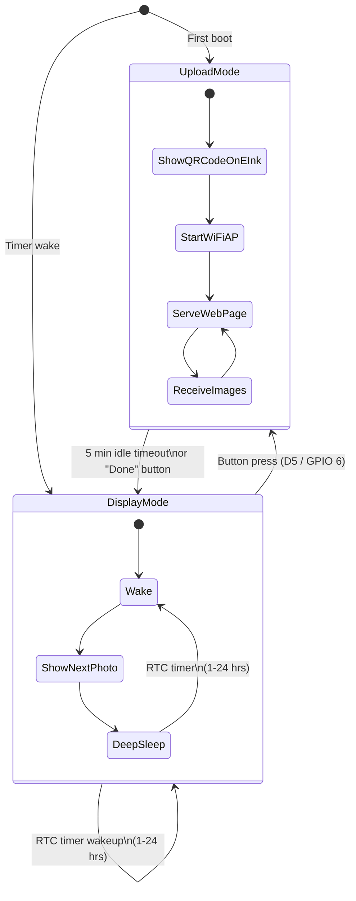

# DIY E-Ink Photo Album (PicPak Clone) — XIAO ESP32S3 Edition

A battery-powered, self-hosted e-ink photo frame. The **Seeed Studio XIAO ESP32S3** **is** the server — no PC, no Raspberry Pi, no cloud, and no external SD card or charger board required. Upload photos directly from your phone's browser.

## System Overview

```mermaid
flowchart LR
    subgraph phone["Your Phone / PC"]
        A["Browser"]
        B["JS: EXIF + 4:3 Crop\n+ Contrast/Sharpen"]
        C["JS: Floyd-Steinberg\nDithering (4-color)"]
    end
    subgraph device["E-Ink Frame (XIAO ESP32S3)"]
        E["XIAO ESP32S3\n(WiFi AP + Web Server)"]
        F["8MB Onboard Flash\n(6MB LittleFS ~180 photos)"]
        G["4.2\" E-Ink\n(B/W/Y/R)"]
        H["LiPo Battery\n(Built-in USB-C Charging)"]
    end

    A -- "Pick photo" --> B
    B --> C
    C -- "POST /api/upload\n(30KB raw 2bpp)" --> E
    E --> F
    E -- "FSPI" --> G
    H --> E
```

### The Key Trick

The browser does **all** the heavy lifting — EXIF orientation, resizing, cropping, contrast/sharpening, and Floyd-Steinberg dithering. The XIAO ESP32S3 only receives a tiny pre-processed binary (`30,000` bytes), stores it in its onboard 8MB Flash (`LittleFS`), and writes it to the display over SPI.

---

## Two Operating Modes



| Mode | What Happens | Power Usage |
|------|-------------|-------------|
| **Display Mode** (default) | Deep sleep → wake → show next photo from LittleFS → hibernate display → deep sleep | ~14µA sleep (XIAO ESP32S3), ~120mA for 20s every cycle |
| **Upload Mode** (button press) | Displays WiFi QR code on e-ink, creates hotspot `"EinkFrame"`, serves web UI at `192.168.4.1` | ~110mA continuous (5 min idle timeout) |

---

## Hardware Bill of Materials

| # | Component | Approx. Cost | Notes |
|---|-----------|-------------|-------|
| 1 | **Waveshare 4.2" e-Paper Module (G)** — B/W/Y/R, 400×300px | \$25–30 | SPI, 4-color, built-in level shifter |
| 2 | **Seeed Studio XIAO ESP32S3** (8MB Flash, 8MB PSRAM) | \$7–13 | Thumb-sized (21×17.8mm), built-in USB-C LiPo charger, ~14µA deep sleep |
| 3 | **3.7V LiPo Battery** (1500–2000mAh pouch) | \$8–10 | Connects to `BAT+`/`BAT-` pads on underside of XIAO |
| 4 | **Tactile button** (6mm) | \$0.25 | "Upload mode" wake trigger (connects D5 to GND) |
| 5 | **2× 220kΩ resistors** (optional) | \$0.10 | 2:1 voltage divider from `BAT+` to `D0` (`GPIO 1`) for battery % readout |
| 6 | **4× 10×2mm Neodymium Disc Magnets** | \$1.50 | Fridge mounting |
| 7 | **3D-printed enclosure** | \$2–5 filament | PLA or PETG (`enclosure/frame.scad`) |

**Estimated total: ~\$45–60** (No external SD module, TP4056 charger, or MOSFET required!)

---

## Wiring Diagram (XIAO ESP32S3)

```
Seeed XIAO ESP32S3                 Waveshare 4.2" Module (G)
──────────────────                 ─────────────────────────
3V3            ─────────────────── VCC
GND            ─────────────────── GND
D10 (GPIO 9)   ─────────────────── DIN (MOSI)
D8  (GPIO 7)   ─────────────────── CLK (SCK)
D1  (GPIO 2)   ─────────────────── CS
D2  (GPIO 3)   ─────────────────── DC
D3  (GPIO 4)   ─────────────────── RST
D4  (GPIO 5)   ─────────────────── BUSY

Upload Wake Button
──────────────────
D5  (GPIO 6)   ──── [Button] ───── GND   (Internal RTC pull-up enabled in firmware)

LiPo Battery & Optional Voltage Divider
───────────────────────────────────────
LiPo (+)       ─────────────────── BAT+ pad (bottom of XIAO)
LiPo (-)       ─────────────────── BAT- pad (bottom of XIAO)
BAT+           ─── 220kΩ ──┬────── D0 (GPIO 1 / ADC1)
                           └── 220kΩ ─── GND
```

---

## Software Architecture

### 1. Firmware (`firmware/`)
- **[`platformio.ini`](file:///d:/antigravity/eink-display/firmware/platformio.ini)**: Configured for `seeed_xiao_esp32s3` with USB CDC enabled and [`partitions_8MB.csv`](file:///d:/antigravity/eink-display/firmware/partitions_8MB.csv) (`~6MB` LittleFS partition).
- **[`src/config.h`](file:///d:/antigravity/eink-display/firmware/src/config.h)**: XIAO ESP32S3 pin mappings and `MAX_PHOTOS = 180`.
- **[`src/main.cpp`](file:///d:/antigravity/eink-display/firmware/src/main.cpp)**: Wakes from deep sleep, checks wakeup reason (`ext0` button vs. RTC timer), and runs either Upload Mode or Display Mode.
- **[`src/display_driver.cpp`](file:///d:/antigravity/eink-display/firmware/src/display_driver.cpp)**: Uses hardware `FSPI` and `GxEPD2_420c_GDEY0420F51` to unpack 2bpp images and render the Upload Mode WiFi QR code screen, then calls `_display->hibernate()` (~2µA panel sleep).
- **[`src/storage_manager.cpp`](file:///d:/antigravity/eink-display/firmware/src/storage_manager.cpp)**: Stores photos as `/p/0001.bin` … `/p/0180.bin` in LittleFS and persists settings (`refreshHours`, `cycleMode`, `currentIndex`) in `/config.json`.
- **[`src/web_server.cpp`](file:///d:/antigravity/eink-display/firmware/src/web_server.cpp)**: Runs `ESPAsyncWebServer` + captive portal `DNSServer`:
  - `GET /`, `/style.css`, `/app.js` — Static web UI
  - `POST /api/upload` — Receives 30,000-byte 2bpp image
  - `GET /api/photos` — JSON list of stored photo IDs
  - `GET /api/photos/:id.bin` — Raw 30KB photo binary for live canvas thumbnail rendering
  - `DELETE /api/photos/:id` — Delete photo
  - `POST /api/display/:id` — Asynchronously queues immediate e-ink display refresh on main loop
  - `GET /api/status` & `POST /api/settings` — Battery %, photo count, and settings management
  - `POST /api/exit` — Exits Upload Mode and enters deep sleep

### 2. Web Upload App (`firmware/data/`)
- **[`index.html`](file:///d:/antigravity/eink-display/firmware/data/index.html)**, **[`style.css`](file:///d:/antigravity/eink-display/firmware/data/style.css)**, **[`app.js`](file:///d:/antigravity/eink-display/firmware/data/app.js)**:
  - Drag-and-drop / mobile camera roll picker
  - Side-by-side preview modal (cropped original vs. 4-color Floyd-Steinberg dithered simulation)
  - Live thumbnail gallery rendered from `/api/photos/:id.bin` with one-tap "Show on E-Ink" and delete actions
  - Instant settings pills for Refresh Interval (`1h`–`24h`) and Cycling Order (`Sequential` / `Random`)

### 3. 3D-Printed Enclosure (`enclosure/frame.scad`)
- **[`enclosure/frame.scad`](file:///d:/antigravity/eink-display/enclosure/frame.scad)**: Polaroid-proportioned front bezel, rear pocket with plenty of room for the ultra-compact XIAO ESP32S3 + LiPo pouch, USB-C cutout, side button pinhole, 4× magnet pockets, and a flush-stowing fold-out kickstand.
